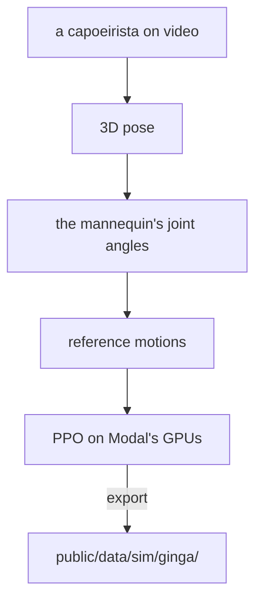
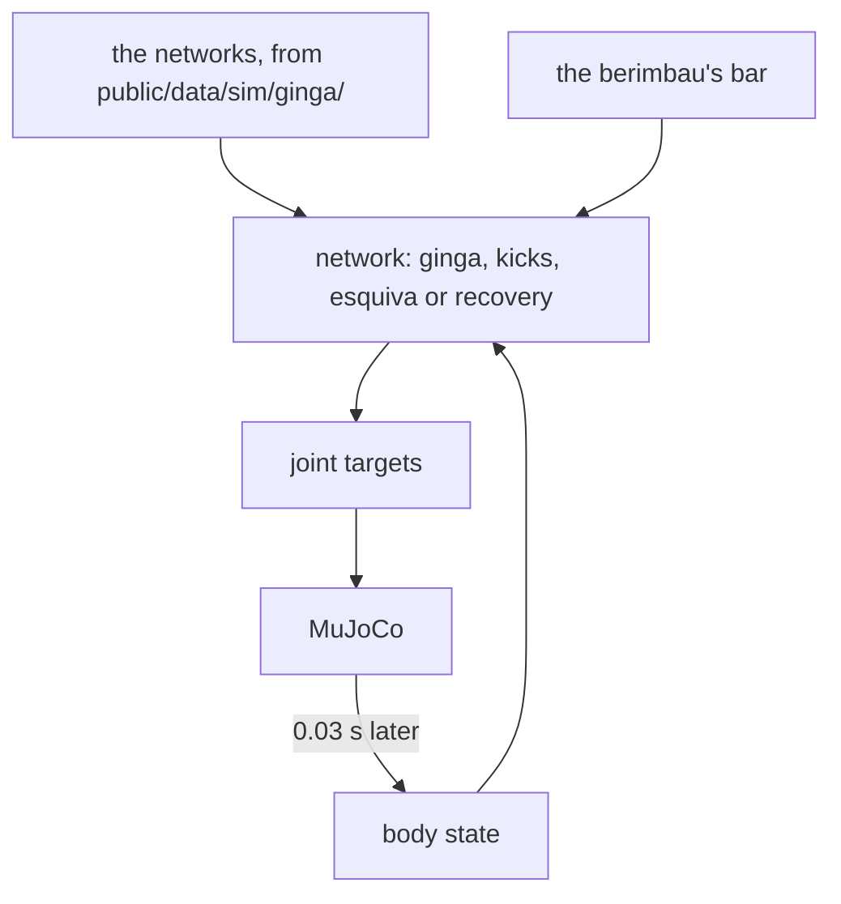

# capoeira simulator

**English** · [Português](README.pt-BR.md)

Can a machine learn capoeira?

https://github.com/user-attachments/assets/dfddc6f9-33ba-4223-b176-dea17ac0d75b

Sound on! The berimbau is synthesized in your browser too.

Try it in your browser: **[flplima.github.io/capoeira-simulator](https://flplima.github.io/capoeira-simulator/)**

> [!WARNING]
> _Early days, and entirely vibe-coded. The body still falls more than any capoeirista would._

## what is it?

A 70 kg mannequin in [MuJoCo](https://mujoco.org), the physics engine,
running in your browser. Neural networks move it. They learned by trial and error to imitate a
capoeirista on video (reinforcement learning, in the
[DeepMimic](https://github.com/xbpeng/DeepMimic) style).

## how it works

Training, on Modal's GPUs:

In your browser, every 0.03 s:

The training pipeline lives in [`ml/`](ml/README.md) (Python, docs in
Portuguese). The app is Vite, React and Three.js, and `src/sim/` re-runs the
same environment as `ml/env.py`, checked against it in `npm test`. The rig,
the berimbau, the movement files and the training are in
[docs/how-it-works.md](docs/how-it-works.md).

## credits and licences

- **Martelo reference**: fitted to "Martelo -- Capoeira movimento + slow
  motion", by the [Capoeira Nantes](https://www.youtube.com/watch?v=ZCLVQIfaPHE)
  YouTube channel. No footage is in this repository, only the joint angles
  fitted to it (in `public/data/sim/ginga/reference.json`).
- **Ginga reference**: fitted to a two-camera (front and side) video of a
  capoeirista with MediaPipe Pose (Apache-2.0).
- **[GVHMR](https://github.com/zju3dv/GVHMR)** (Shen et al., SIGGRAPH Asia
  2024) turns the martelo video into 3D pose. It is licensed for educational,
  research and non-profit use only, and commercial use needs the authors'
  permission. It is not vendored here: `ml/hmr_modal.py` clones it when the
  Modal image builds.
- **[SMPL](https://smpl.is.tue.mpg.de) and [SMPL-X](https://smpl-x.is.tue.mpg.de)**:
  the body models GVHMR needs. They need a sign-up, have their own
  non-commercial research licences, and are not in this repository.
- **[MuJoCo](https://github.com/google-deepmind/mujoco)** (Apache-2.0, Google
  DeepMind), including its WebAssembly build `@mujoco/mujoco`.
- **Papers**: DeepMimic (Peng et al. 2018) for the reward and the imitation
  setup, KungfuBot (Xie et al. 2025) for adaptive tracking tolerances,
  Abdolhosseini et al. 2019 for the symmetry loss, de Leva 1996 for segment
  masses.
- **Keyframe moves** were posed by hand from the sources in
  [RESEARCH.md](RESEARCH.md).

So: the code is MIT. The motion references and the networks trained on them
come from that research-only chain and from third-party video, so this
project is non-commercial. Reusing those files commercially means clearing
GVHMR, SMPL-X and the video's owners yourself.

## contributing

Any contribution is welcome, and so are AI agents! [AGENTS.md](AGENTS.md) has
the rules, and [docs/CI-TRIAGE.md](docs/CI-TRIAGE.md) maps each CI job to the
command that runs it locally.

## licence

[MIT](LICENSE), for the code.
