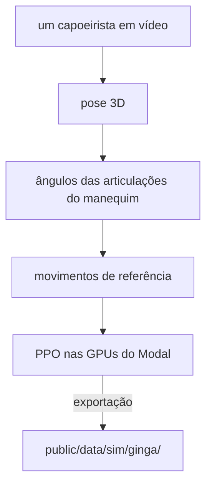
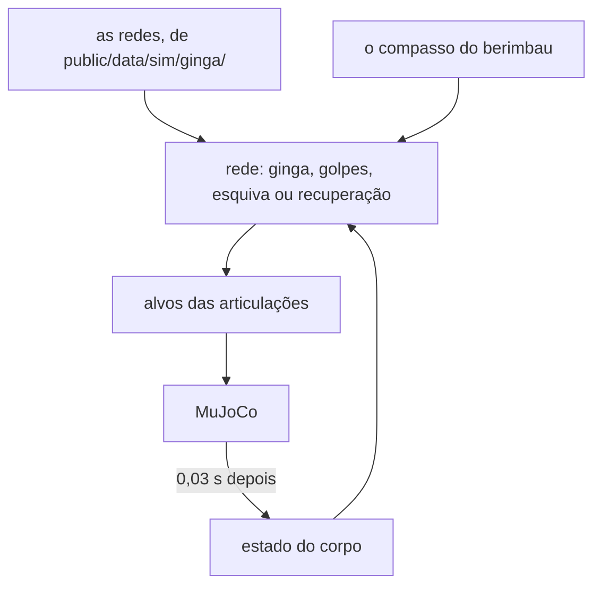

# capoeira simulator

[English](README.md) · **Português**

Uma máquina consegue aprender capoeira?

https://github.com/user-attachments/assets/dfddc6f9-33ba-4223-b176-dea17ac0d75b

Som ligado! O berimbau também é sintetizado no seu navegador.

Experimente no navegador: **[flplima.github.io/capoeira-simulator](https://flplima.github.io/capoeira-simulator/?lang=pt)**

> [!WARNING]
> _Ainda no começo, e todo feito no vibe coding. O corpo ainda cai mais do que qualquer capoeirista._

## o que é?

Um manequim de 70 kg no [MuJoCo](https://mujoco.org), o motor de física,
rodando no seu navegador. Redes neurais movem o corpo. Elas aprenderam por
tentativa e erro a imitar um capoeirista em vídeo (aprendizado por reforço, no
estilo do [DeepMimic](https://github.com/xbpeng/DeepMimic)).

## como funciona

O treino, nas GPUs do Modal:

No seu navegador, a cada 0,03 s:

O treino fica em [`ml/`](ml/README.md) (Python, documentação em português). O
app é Vite, React e Three.js, e o `src/sim/` roda o mesmo ambiente do
`ml/env.py`, conferido contra ele no `npm test`. O rig, o berimbau, os
arquivos de movimento e o treino estão em
[docs/how-it-works.md](docs/how-it-works.md) (em inglês).

## créditos e licenças

- **Referência do martelo**: ajustada a "Martelo -- Capoeira movimento + slow
  motion", do canal [Capoeira Nantes](https://www.youtube.com/watch?v=ZCLVQIfaPHE)
  no YouTube. Nenhuma imagem do vídeo está neste repositório, só os ângulos
  das articulações ajustados a ele (em `public/data/sim/ginga/reference.json`).
- **Referência da ginga**: ajustada a um vídeo de um capoeirista, com duas
  câmeras (frente e lado), usando o MediaPipe Pose (Apache-2.0).
- **[GVHMR](https://github.com/zju3dv/GVHMR)** (Shen et al., SIGGRAPH Asia
  2024) transforma o vídeo do martelo em pose 3D. A licença dele é só para
  uso educacional, de pesquisa e sem fins lucrativos, e uso comercial precisa
  da permissão dos autores. Ele não está copiado aqui: o `ml/hmr_modal.py` o
  clona quando a imagem do Modal é construída.
- **[SMPL](https://smpl.is.tue.mpg.de) e [SMPL-X](https://smpl-x.is.tue.mpg.de)**:
  os modelos de corpo de que o GVHMR precisa. Pedem cadastro, têm as próprias
  licenças de pesquisa não comercial e não estão neste repositório.
- **[MuJoCo](https://github.com/google-deepmind/mujoco)** (Apache-2.0, Google
  DeepMind), incluindo a versão em WebAssembly, `@mujoco/mujoco`.
- **Artigos**: DeepMimic (Peng et al. 2018) para a recompensa e a imitação,
  KungfuBot (Xie et al. 2025) para as tolerâncias adaptativas, Abdolhosseini
  et al. 2019 para a perda de simetria, de Leva 1996 para as massas dos
  segmentos.
- **Movimentos de quadros-chave** foram posados à mão a partir das fontes do
  [RESEARCH.md](RESEARCH.md).

Ou seja: o código é MIT. As referências de movimento e as redes treinadas
nelas vêm dessa cadeia só para pesquisa e de vídeo de terceiros, então este
projeto não é comercial. Quem quiser usar esses arquivos comercialmente
precisa acertar isso com o GVHMR, o SMPL-X e os donos do vídeo.

## contribuindo

Toda contribuição é bem-vinda, e agentes de IA também! O
[AGENTS.md](AGENTS.md) tem as regras, e o
[docs/CI-TRIAGE.md](docs/CI-TRIAGE.md) mostra o comando local de cada job do
CI.

## licença

[MIT](LICENSE), para o código.
